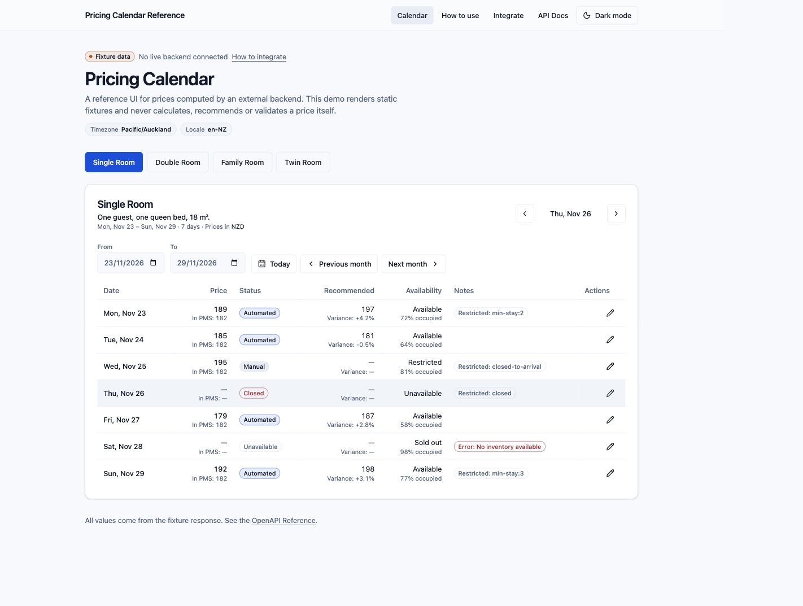
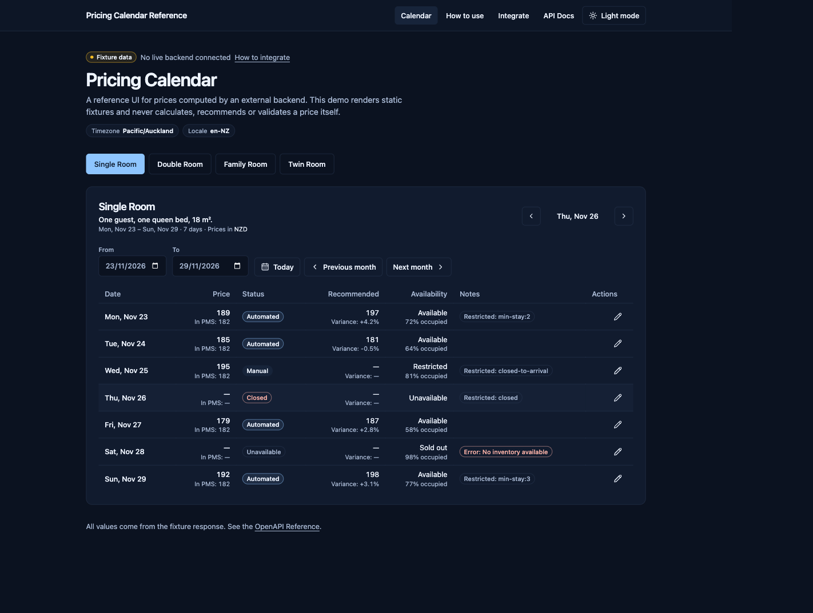
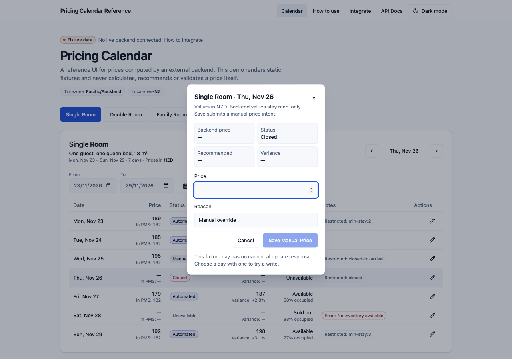
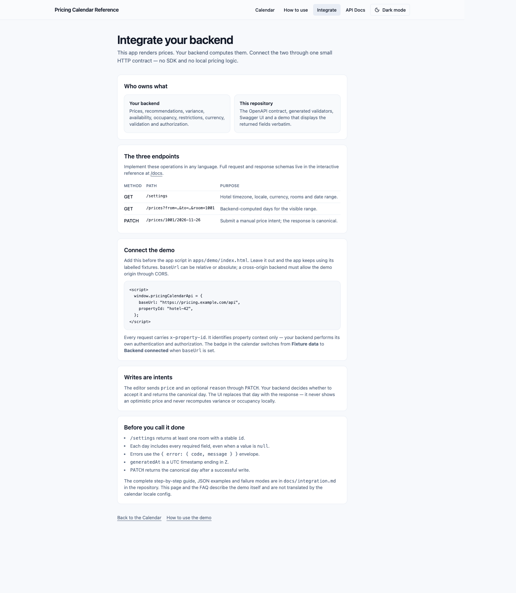
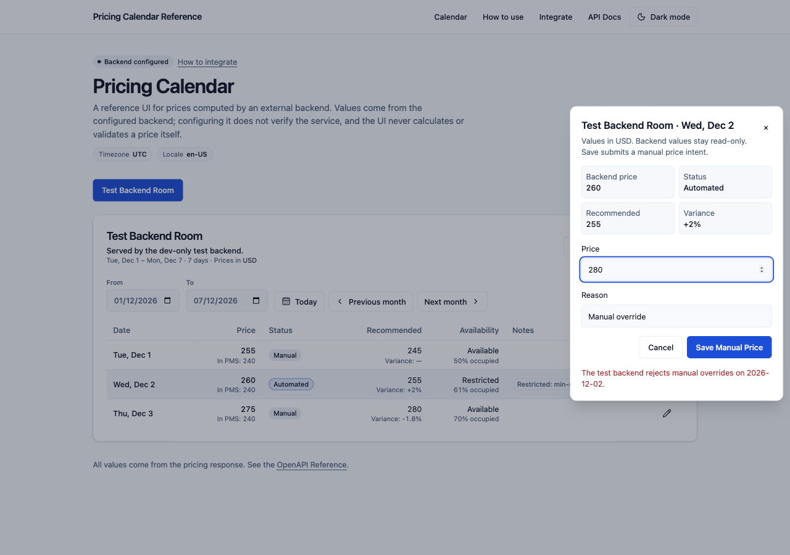

# Pricing Calendar Reference App

A contract-first reference application: a calendar that displays prices computed by an external backend. This repository owns the HTTP contract, interactive API documentation and one configurable demo. It does not compute prices, ship an SDK, provide a production backend, or claim that a conforming external backend exists.

## The promise

- One canonical [OpenAPI 3.1.1 contract](packages/contracts/openapi.yaml) with three operations: `GET /settings`, `GET /prices` and `PATCH /prices/{roomId}/{date}`.
- One Vite demo that renders the fields returned by a backend. Static labelled fixtures are the default; a `baseUrl` config switches it to a configured backend. The badge reports configuration, not connectivity.
- Interactive API reference at `/docs`, a user FAQ at `/faq` and a developer guide at `/integrate`, all linked from the app header.
- Generated Zod validators that keep the demo and its tests aligned with the contract.

This is **not** an SDK, a production backend, a pricing engine, a persistence layer, or a conformance certificate for any external implementation.

## Repository layout

```text
apps/
  demo/                Vite app: calendar, /faq and /integrate guides, Swagger UI at /docs
                       test-backend.mjs + test-backend.html: dev-only configured-backend double
packages/
  contracts/           Canonical OpenAPI contract and generated Zod validators
docs/
  integration.md       Integration guide for backend teams
  adr/                 Architecture decision records
```

## Contract

The language-neutral wire contract is [`packages/contracts/openapi.yaml`](packages/contracts/openapi.yaml), OpenAPI 3.1.1. It describes `GET /settings`, `GET /prices` and `PATCH /prices/{roomId}/{date}`, including query parameters, headers, bodies, responses and errors.

A backend implements that contract; `x-property-id` identifies the request context and the backend authorizes it. No SDK package is published and no backend conforming to the contract is asserted here.

By default the demo uses explicit, static fixtures, visibly labelled as such. When a `baseUrl` is configured it renders responses from that backend instead; the badge reports configuration, not connectivity. Prices, recommendations, variance, availability, occupancy, restrictions, currency and business validation always come from the response, never from local calculations.

## Running the demo

Prerequisites: Node 26 and pnpm 12.9.1.

```bash
pnpm install
pnpm dev
```

The demo runs on Vite. A usage FAQ is served at `/faq`, a developer guide at `/integrate`, and interactive API documentation at `/docs`; all three are linked from the calendar header. The room selector follows the backend's rooms, the visible range uses `?from=` and `?to=`, and the selected room and date are reflected in `?room=` and `?date=`. Selecting a day highlights it; the pencil action opens an anchored native dialog, and `?edit=1` shares it. The header switches themes and saves the choice locally.

## Screenshots

| Calendar — light | Calendar — dark |
| --- | --- |
| [](docs/screenshots/calendar-light.png) | [](docs/screenshots/calendar-dark.png) |

| Day editor | Developer guide |
| --- | --- |
| [](docs/screenshots/day-editor.png) | [](docs/screenshots/integrate.png) |

| Configured path — dev test backend |
| --- |
| [](docs/screenshots/backend-test.png) |

The first four images were captured from the static fixtures. The last one shows the configured path against the dev-only test backend, including a backend rejection. None shows a production integration. Click an image to open it at full size.

## Integrate your backend

The demo uses labelled fixtures until you configure a base URL. Add this before the app script in `apps/demo/index.html`:

```html
<script>
  window.pricingCalendarApi = {
    baseUrl: "https://pricing.example.com/api",
    propertyId: "hotel-42",
  };
</script>
```

Your backend implements `GET /settings`, `GET /prices` and `PATCH /prices/{roomId}/{date}` from [`packages/contracts/openapi.yaml`](packages/contracts/openapi.yaml), sends `x-property-id`, and owns every pricing decision. No SDK is published. The first visible range comes from `settings.dateRange` unless `?from=` and `?to=` are supplied; the **Backend configured** badge does not imply a successful health check. The full step-by-step guide, JSON examples, conformance checklist and failure modes are in [`docs/integration.md`](docs/integration.md); the same essentials are available inside the app at `/integrate`. Calendar copy can be supplied through `window.pricingCalendarI18n` with no runtime i18n dependency.

To exercise the real `fetch` and `PATCH` flow without a production backend, run `pnpm dev` and `pnpm dev:test-backend` in separate terminals, then open <http://127.0.0.1:3001/test-backend.html>. The dev-only test double uses static values on its own date range, accepts ordinary saves and rejects one date with an error envelope; it is not a conformance implementation.

## Available scripts

| Script | Description |
|---|---|
| `pnpm dev` | Start the Vite demo |
| `pnpm dev:test-backend` | Start the dev-only configured-backend test double |
| `pnpm build` | Build the demo |
| `pnpm start` | Preview the demo build |
| `pnpm lint` | Run Biome checks |
| `pnpm lint:fix` | Apply Biome fixes |
| `pnpm typecheck` | Type-check the workspace and the demo |
| `pnpm test` | Run Vitest in watch mode |
| `pnpm test:run` | Run Vitest once |
| `pnpm --filter @hpc/contracts generate` | Generate runtime Zod schemas from OpenAPI |
| `pnpm --filter @hpc/contracts check:generated` | Check generated schemas are current |

## Verification

```bash
pnpm --filter @hpc/contracts check:generated
pnpm lint
pnpm typecheck
pnpm test:run
pnpm build
```

The same commands run in CI on pushes and pull requests to `main`.

## Documentation

- [Integration guide](docs/integration.md)
- In-app usage guide: `/faq` in the demo app
- In-app developer guide: `/integrate` in the demo app
- [OpenAPI contract](packages/contracts/openapi.yaml)
- Interactive API reference: `/docs` in the demo app
- [ADR-0012 — Pivot to a contract-first reference app](docs/adr/0012-pivot-to-reference-app.md)
- [ADR-0001 — Headless backend-driven direction](docs/adr/0001-headless-backend-driven-direction.md)
- [ADR-0010 — OpenAPI as the canonical API contract](docs/adr/0010-openapi-canonical-api-contract.md)
- [Repository audit](docs/repository-audit.md) — historical pre-migration snapshot
- ADRs marked superseded by ADR-0012 describe the retired SDK/Start/Mantine architecture and are kept for history only.

## Limitations

- No SDK or distributable package is published. Integration is the HTTP contract plus the `window.pricingCalendarApi` config.
- No production backend ships here. Fixtures are static and only demonstrate the wire shape; the dev-only test backend does the same for the configured path. Neither is a conformance test.
- This repo computes no prices, recommendations, variance or validation. Zod checks response shape, not whether a backend's business rules are correct.
- A cross-origin backend must allow the demo origin and the `x-property-id` header. There is no proxy or authentication UI.
- The property id is fixed at boot; there is no runtime property switcher. The backend must authorize each request. The badge reflects `baseUrl` configuration, not backend availability.
- Visible ranges are capped at 366 days; reversed ranges return no days.
- Locale support is an English key registry with simple `{name}` interpolation: no plural rules and no bundled translations. `/faq`, `/integrate`, `/docs` and shared chrome stay in English.
- No realtime updates, offline mode or backend persistence; only the theme choice is stored locally. URL parameters carry selection and editor state.
- Writes are intents: the backend may reject them, and the UI always shows the returned canonical day instead of an optimistic value.

## License

MIT — see [LICENSE](LICENSE).
